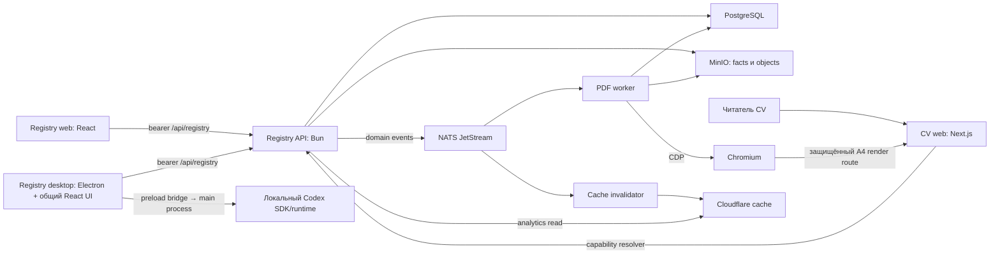
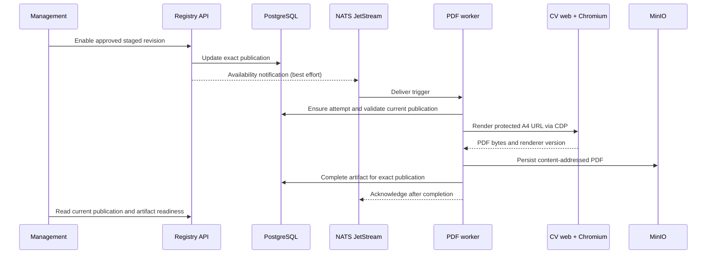

# Архитектура CV workspace

CV workspace объединяет персональный реестр вакансий, подготовку документов
под вакансию и публикацию резюме. Здесь описаны реализованные границы и потоки;
практические команды работы агента находятся в [AGENTS.md](AGENTS.md), запуск
на localhost — в [локальной инструкции](docker/local/README.ru.md).

## 1. Продуктовая модель

Пользователь ведёт вакансии и отклики, хранит заметки и статусы, передаёт ссылку
на вакансию и получает подготовленные документы. Генерация опирается на
предварительно опубликованный каталог опыта кандидата — Reviewed facts.
Результат проходит ручную проверку; утверждённое CV можно опубликовать и
получить PDF с соответствующей ссылкой/QR.

Основной сценарий:

```text
cv-content → facts release → активный каталог кандидата
                                  ↓
URL вакансии → snapshot → анализ и evidence plan → CV → cover letter
                                                  ↓          ↓
                                              ручная проверка
                                                  ↓
                                        утверждённая revision CV
                                                  ↓
                                       публикация → PDF → отправка
```

Обработка вакансий и подготовка документов не означают автоматическую отправку
отклика. Рабочая модель персональная: отдельной tenant/user-модели и выбора
профилей кандидатов в основном сценарии нет. Языки документов определяются
опубликованным facts release, а не произвольным переключателем перевода.

## 2. Компоненты и сетевые границы



Стрелки показывают основные взаимодействия, а не общую транзакцию. Генерация
через Codex не проходит через API сервера. Public CV renderer не подключается
к PostgreSQL/MinIO и не получает management bearer token.

### Runtime applications

| Путь | Ответственность | Runtime |
| --- | --- | --- |
| `apps/application-registry` | Вакансии, документы, reviewed facts, workflows UI, публикация и аналитика | React 19, Vite, React Router; production static Nginx |
| `apps/application-registry-desktop` | Native host, credentials, IPC, schema-constrained генерация и assistant | Electron, Codex SDK |
| `apps/application-registry-api` | Общий HTTP API, auth/CORS, facts publication, capability resolvers, composition Layers | Bun, Effect HTTP |
| `apps/cv` | Public CV, private preview, отдельный A4 route и health | Next.js App Router; production standalone Node |
| `apps/application-registry-pdf-worker` | Consumer PDF events; PostgreSQL/S3 adapters и Chromium CDP adapter | Node, Effect, Playwright |
| `apps/application-registry-cache-invalidator` | Consumer изменения CV и purge публичного `/c/` кеша | Bun, Effect |
| `apps/application-registry-listing-check-runner` | Одноразовый claim/check/finalize запуска проверок вакансий | Bun, Effect; периодический Nomad job |
| `apps/application-registry-mcp-server` | Локальные stdio MCP tools для работы с реестром через общий API | Bun, Effect MCP |

MCP — клиент API, а не отдельный backend. Его correspondence tool записывает
заметку о Gmail message и при необходимости меняет статус; он сам не является
почтовым crawler. Периодические listing checks также отделены от захвата
вакансии для подготовки CV.

## 3. Слои библиотек и ответственность

```text
React/desktop/MCP/API handlers
        ↓ публичные contracts и typed clients
application-registry/service
        ↓ persistence и transport-neutral ports
crud          artifact-store          events
 ↓                  ↓                   ↓
PostgreSQL         MinIO             events-nats
```

Это карта ответственности: типы entity и contracts используются несколькими
слоями. Чистые workflows генерации и PDF находятся в собственных библиотеках,
а приложения предоставляют им конкретные адаптеры.

| Библиотека | Что принадлежит ей |
| --- | --- |
| `application-registry/entity` | Drizzle tables, constrained values, codecs и query definitions; SQL migrations |
| `application-registry/crud` | SQL, persistence outcomes, транзакции и atomic aggregate operations |
| `application-registry/service` | Бизнес-операции, версии, идемпотентность, approvals, публикации и coordination |
| `application-registry/api-contract` | Единственный Effect HttpApi, transport schemas/codecs и OpenAPI |
| `application-registry/api-client` | Клиент, производный от HttpApi, и bearer boundary |
| `application-registry/artifact-store` | Content-addressed object storage port и S3 adapter |
| `application-registry/events` | Версионированные domain events, publisher/source ports |
| `application-registry/events-nats` | JetStream publisher/source Layers, доставка и acknowledgment |
| `application-registry/preparation-workflow` | Чистый workflow подготовки, prompts, evidence/provenance checks, review и progress |
| `application-registry/pdf-processing` | PDF invariants, ensure/render/complete, failure/retry policy и layout checks |
| `application-registry/listing-check` | HTTP observations, provider-specific проверки и классификация доступности |
| `application-registry/desktop-contract` | Узкий IPC contract и schemas запросов/ответов bridge |
| `cv-contracts` | Версионированные document, facts, guidance и delivery schemas |
| `facts-authoring` | Авторские TypeScript schemas, locale parity и детерминированная композиция каталога |
| `facts-release` | Компиляция immutable release и проверка полного bundle |
| `facts-reader` | Read-only верификация активного release и каталога |

Общие UI библиотеки: `internal-ui`, `internal-forms`, `schema-editor`,
`internal-charts`, `color-scheme`. Query stack состоит из `drizzle-query`,
`drizzle-query-effect` и `drizzle-query-ui`: entity задаёт возможности фильтрации,
backend компилирует запрос, UI выводит controls из той же metadata. Конкретные
таблицы вакансий и их TanStack Table configuration остаются в management app.

### Непрозрачность документов на backend

Registry content services знают contract ID/version, locale, hash, byte length,
media type и source pins. Payload хранится и передаётся как bytes. Backend не
должен знать поля `person`, `experience` или структуру facts catalogue.

Document/facts schemas декодируются там, где данные используются: в facts
compiler/reader, generation/editor и renderer. Отдельный facts publication
boundary проверяет bundle/manifest и immutable objects; это не делает registry
content service редактором документа.

`@cv/contracts` специально не имеет root export. `/delivery` содержит
метаданные доставки; `/document` и `/facts` — соответствующие доменные schemas.
Версионированный contract ID нельзя менять на месте, если активные данные ещё
используют прежнюю структуру.

## 4. Хранение и модель данных

| Данные | Где хранятся | Срок жизни |
| --- | --- | --- |
| Вакансии, статусы, labels, notes, activities, compensation | PostgreSQL | Между сессиями |
| Job snapshots и metadata revisions/publications/artifacts | PostgreSQL; payload bytes в MinIO | Между сессиями |
| Facts manifests, catalogues, guidance и assets | Приватный facts bucket MinIO | Immutable release; mutable pointer активации |
| Сырые материалы, документы и PDF | Objects bucket MinIO | Content-addressed objects |
| События и состояние доставки | NATS JetStream | Ограничено настройками retention/consumer |
| Активные preparation/publication workflows и review handles | Memory engine в renderer | До reload/закрытия renderer |
| Dirty draft и undo/redo редактора | Editor session | Локальная сессия документа до сохранения |
| Connection settings | Browser local storage или Electron safeStorage | Локально между запусками |

У application есть одна публичная opaque identity; сервер обычно выдаёт UUID.
`postingUrl` — внешняя ссылка. Приватные normalized URL/fingerprint columns
поддерживают lookup и deduplication; второго публичного job key нет.

Application status — поле aggregate (`not_started`, `preparing`, `applied`,
этапы интервью, `offer`, `rejected`, `withdrawn`, `archived` и др.). Activities
фиксируют уже выполненные backend-операции и не являются event-sourced командами.

Content entry объединяет версии документа для application/kind/locale.
Immutable revisions образуют линейную историю с head и approved reference.
Ревизия закрепляет facts release и job snapshot. `facts_release_id` — provenance
text, а не foreign key: facts releases не представлены отдельными таблицами БД.

CV link содержит текущую revision, стабильный public token/URL, private preview
capability, `enabled` и publication version. PDF artifact привязан к точной
связке revision/version/URL; существование старого PDF недостаточно для готовности
нового состояния.

Schema ownership и миграции:

- Источник — `libs/application-registry/entity/src/tables` и соседние codecs/query.
- История — `libs/application-registry/entity/drizzle`.
- Применение — `apps/application-registry-api/scripts/run-migrations.sh`.
- Journal — `application_registry_schema_migrations`, включая checksum SQL.
- API `main.ts` сам миграции не запускает: Compose использует отдельный `migrate`,
  production — pre-start задачу.

## 5. HTTP и credentials

| Граница | Контракт доступа |
| --- | --- |
| `GET /health` | Публичная liveness-проверка API |
| `/api/registry/*` | Registry bearer token; facts publication использует отдельный publication token |
| `GET /api/registry/health` | Проверка доступа с Registry token; не полная диагностика зависимостей |
| `/openapi.json` | Описание общего HttpApi |
| `/cv-publications/:token` | Разрешение опубликованных bytes по capability token |
| `/cv-previews/:token?access=...` | Дополнительная preview capability |
| CV `/c/:token` | Публичное CV, если публикация разрешена |
| CV `/c/_preview/:token?access=...` | Приватное web preview |
| CV `/c/_render/:token?access=...` | Защищённый A4 render для Chromium |
| CV `/c/_internal/health` | Проверка renderer |

Canonical management prefix — `/api/registry`. Web запрашивает API напрямую с
выбранным origin и bearer token; CORS сервера разрешает конкретные origins.
В desktop main process подставляет credentials за preload bridge. В frontend
build нет постоянных storage credentials или вшитого Registry token.

Query wire format задают codecs из `api-contract`: текущие URL-параметры
`filter`, `sort`, `after`, `size`, а для application search также `q`.
Внутренняя decoded-модель может использовать `filters`/`orderBy`; это не повод
передавать их как старые JSON query parameters. Ориентиры — `commands.ts`,
`contract.test.ts` и `src/table-workspace/query-codecs.ts`.

Retryable mutations передают `idempotency-key` в header. Optimistic operations
передают `expectedVersion`. Service/CRUD различают повтор операции и конфликт
конкурирующего изменения. Aggregate projections, revision, activity и receipt
в соответствующих CRUD workflows сохраняются атомарно.

Отдельные credentials имеют разные роли: Registry API token, facts publication
token, server-side MinIO keys, NATS credentials, analytics-read/purge tokens
Cloudflare и нативная авторизация Codex. Public resolver опирается на capability,
а не на management token. Preview/render responses не кешируются публично.

## 6. Поток Reviewed facts

```text
Отдельный cv-content checkout
  facts.config.ts + typed sections + assets + guidance
       ↓ facts-authoring: schemas, locale parity, deterministic IDs
  facts-release: immutable objects и manifest
       ↓ facts-toolchain: check → build → publish
  API facts publication: verify → register → compare-and-set activate
       ↓
  MinIO facts bucket: current.json → release manifest → locale/guidance/assets
       ↓ facts-reader: schema + hash + length + media-type verification
  Management и preparation workflow
```

Форматы: catalogues `cv.facts.v1`, guidance `cv.generation-guidance.v1`, manifest
`cv.facts-release.v2`, bundle `cv.facts-bundle.v1`. Release ID имеет вид
`fr_<manifest-sha256>`. Layout содержит `current.json`,
`releases/<id>/manifest.json`, `releases/<id>/locales/<locale>.json`,
`releases/<id>/generation/cv.json` и `assets/sha256/<digest>`.

Только API записывает facts bucket. Publisher передаёт пакет и publication token,
не получает MinIO credentials. `facts-reader` не имеет операций записи и S3 client.
Активация release отдельно от регистрации immutable objects защищена
expected-current compare-and-set.

`tools/facts-release` — CLI с Nx-именем `facts-toolchain`.
`tools/facts-types` генерирует переносимые authoring declarations для внешнего
content checkout. Факты не создаются автоматически при запуске Compose;
fixture renderer также не публикует кандидатский каталог.

## 7. Подготовка документов и desktop

Shared React source выбирает browser или desktop host adapter. Browser использует
обычные routes и локально сохранённое API-соединение; desktop — hash routing и
context-isolated Electron preload. AI workflow entrypoint виден только в desktop.

Workflow принимает `PostingUrl` либо `ExistingApplication` с закреплёнными
application/snapshot/facts release/URL. Для новой ссылки требуется CV, письмо
опционально. Один batch содержит до 25 targets.

Порядок обработки одного job:

1. Создать/найти application, захватить posting snapshot и закрепить facts release.
2. Проанализировать требования вакансии и построить evidence plan.
3. Сформировать CV authoring plan, скомпоновать и проверить документ.
4. Сохранить неутверждённую revision; при запросе подготовить письмо с тем же CV
   context. Ошибка письма не должна уничтожать уже доступный CV.
5. Ожидать отдельное решение review для каждого artifact.
6. Перед approval проверить head, ancestry допустимых edits/refinements и
   неизменность entry/contract/facts/job pins, затем изменить registry с версией.

Получение вакансии остаётся на сервере: обычный HTTP fetch с timeout и лимитом
payload, а не полноценный browser crawler. Закрытые страницы, CAPTCHA и контент,
существующий только после JS execution, могут не обработаться.

Generation-visible evidence строится в
`libs/application-registry/preparation-workflow/src/generation/evidence.ts`.
Текущая проекция оставляет только public contacts/projects, фильтрует private
links в соответствующих разделах и сохраняет experience. Provenance checks
ограничивают выбираемые IDs и структуру; семантическая достоверность прозы
по-прежнему требует проверки человеком.

Main process запускает schema-constrained turns через закреплённый Codex SDK.
Его restricted options запрещают web search и доступ к сети для инструментов,
используют read-only sandbox и `approvalPolicy: never`. Это ограничения работы
агента с инструментами, а не утверждение об офлайн-генерации: модель требует
своего backend. Credentials/model settings берутся из нативной установки Codex.
Встроенный document assistant может продолжать свой SDK thread; pipeline
одноразовой генерации создаёт новый thread.

### Владельцы состояния подготовки

| Владелец | Состояние |
| --- | --- |
| `preparation/data` | Registry queries, remote mutations и cache invalidation |
| Workflow package | Job, artifact branches, generation/review invariants и progress |
| `preparation/workflow` | Host gateways, Effect Atom adapters, memory engine composition |
| `preparation/publication` | Enablement, PDF readiness и publication progress |
| `preparation/document-state` | Original/draft, history, validation и assistant patch state |
| `preparation/document-workspace` | Semantic editor, local preview и interaction |
| `preparation/guidance` | Release-keyed local overrides правил написания CV |

Provider живёт выше RouterProvider: навигация не останавливает jobs. Engine
сейчас `WorkflowEngine.layerMemory`. Reload/HMR, закрытие окна и перезапуск
теряют execution/review handles; сохранённые revisions и server-side публикации
остаются. Другая вкладка не разделяет тот же memory runtime.

Роуты: `/applications`, `/facts`, `/activities`, `/analytics`,
`/preparation/cv-guidance` и иерархия `/ai-workflows/...`. Detailed routing и
editor lifecycle описаны в
[preparation README](apps/application-registry/src/preparation/README.md).

## 8. Публикация, события и PDF

Публикация — отдельный workflow. Сохранение CV подготавливает приватную запись страницы и обновляет
preview capability; утверждение revision и enablement публичной страницы —
разные операции. UI считает CV готовым для отправки, когда текущая страница
включена и PDF для точной связки revision/version/URL имеет статус `ready`.



Основные events: `CvPublicationChanged`, `CvPublicationAvailabilityChanged`,
`PdfGenerationRequested`. Их versioned subjects находятся под `registry.events.>`
в `REGISTRY_EVENTS`.

Publication notifications публикуются best effort после DB mutation. Явный
PDF generation request требует успешной публикации события. Общей атомарной
транзакции PostgreSQL+NATS и exactly-once гарантии нет. Стабильные event IDs и
JetStream duplicate window помогают повтору, но consumer всё равно идемпотентен.

PDF worker сначала сверяет event с application/entry/revision/publication и
approved revision. Уже завершённый attempt не рендерится заново. Адаптер
Playwright создаёт изолированный context, ждёт fonts/layout, проверяет A4
measurement, renderer version и число PDF pages. Рендерится защищённый A4 route,
связанный с public URL; QR содержит именно public URL, а не render capability.

Transient failures повторяются с heartbeat/nak и ограничением числа доставок.
Перед ack сохраняется окончательная ошибка, включая исчерпание попыток,
если запись ошибки доступна. Невалидные сообщения завершаются через `term`
без повторной доставки. Ошибка отключает только соответствующую всё ещё текущую
публикацию. Retry и re-enable должны снова получить ready PDF.

Cache invalidator независимо читает `CvPublicationChanged` и очищает публичный
`/c/` prefix Cloudflare. Public CV имеет edge-cache policy; preview/render routes
остаются private/no-store. Аналитика читается API через отдельный Cloudflare
analytics-read credential.

## 9. Local Compose и production

| Аспект | Local Compose | Авторский production |
| --- | --- | --- |
| Orchestration | Docker Compose | Nomad Packs, Consul/Connect, Vault |
| Management | Vite dev server | Static Nginx за Cloudflare Access |
| CV renderer | Next.js dev server | Standalone Next.js Node service |
| Public CV URL | Loopback HTTP с явным override | HTTPS по `CV_WEB_HOST` |
| Миграции | Одноразовый `migrate` | API allocation pre-start task |
| Бакеты/JetStream | `docker/local/bootstrap.mjs` | Cluster infrastructure и Terraform topology |
| Chromium | Общий workspace image, отдельный процесс | Внешний generic Chromium service |
| Facts | Отдельный импорт через `facts` tool service | Версионированный content release pipeline |
| Codex/Electron | Нативно на компьютере | Нативно на компьютере |
| Cloudflare и periodic checks | Не запускаются | Отдельные сервисы и periodic Nomad job |

### Особенности localhost

`compose.yaml` создаёт durable PostgreSQL/MinIO/NATS volumes и запускает API
после успешных `migrate`/`bootstrap`. Бакеты и topology создаются повторяемо;
приложения не получают обязанность создавать их при обработке запросов.

API использует явный `CV_LOCAL_PUBLIC_BASE_URL=http://localhost:<CV_PORT>/c/`.
HTTP override допускает только loopback и точный путь `/c/` без credentials,
query и fragment. Обычная конфигурация продолжает строить HTTPS URL.

Chromium и PDF worker используют `network_mode: service:cv`. Их localhost
совпадает с localhost CV-процесса, поэтому public URL/QR работают одинаково
в браузере хоста и в Chromium. CDP не опубликован на хост. Порты API, Registry,
CV и MinIO console публикуются только на 127.0.0.1.

Workspace image содержит Node/Bun, зависимости, собранные библиотеки и Chromium.
В сборку включён `color-scheme`, необходимый renderer. MinIO собирается из
проверяемого по checksum архива закреплённого официального коммита; зависимость
от недоступного предсобранного community image исключена из Compose.

Profile `tools` содержит `facts` и `smoke`. Smoke проверяет инфраструктуру и
прямую печать fixture в PDF, но не заменяет проверку Codex generation и
сквозного publication/event-consumer workflow. Данные facts не входят в образ.

### Граница production infrastructure

Этот репозиторий владеет приложениями, образами, SQL migrations, Nomad Packs,
JetStream application topology, Cloudflare policy и CI workflows. Общие cluster
services, credentials, Consul intentions и generic Chromium allocation описаны
во внешнем `~/infrastructure`. Content authoring находится во внешнем `cv-content`.
Эти соседние репозитории не обязательны для сборки обычного checkout.

CI в [.github/workflows/ci.yml](.github/workflows/ci.yml) отдельно выполняет
quality, builds, миграционный drift check, integration suites и CV e2e.
Production image publication/deployment зависят от event/branch условий и
настроенных credentials; наличие форка само по себе не создаёт инфраструктуру.

## 10. Навигация при разработке

| Требуемое изменение | Начать с |
| --- | --- |
| Новое поле вакансии | Entity table/codecs/query → migration → CRUD/service → API → UI |
| Новый фильтр | Entity-owned query definition → общие codecs и metadata UI |
| Изменение генерации | Workflow domain/generation/gateway validation и их тесты |
| Поведение редактора | `document-state`, затем projection и `document-workspace` |
| Новый документный контракт | `cv-contracts` → producers/readers/renderers; сохранить используемые версии |
| Поведение PDF | `pdf-processing`, затем worker persistence/renderer и CV A4 route |
| Отказ публикации или stale PDF | `service` publication/artifact logic, readiness и version/URL pins |
| Новое domain event | `events` schema → service publisher → `events-nats` subjects → topology/consumer |
| Новый host capability | `desktop-contract` → preload/main → shared host adapter и UI gate |
| Запуск/порты/зависимости | Compose, local Dockerfiles/scripts и локальная инструкция |

Не смешивайте рефакторинг этих границ с добавлением небольшой функции.
При изменении контракта проверяйте producer и consumer, при изменении данных —
миграции и транзакции, при изменении renderer — реальный Chromium/A4.
Подробные команды проверок и правила сохранения данных находятся в
[AGENTS.md](AGENTS.md).

## Ссылки на детальные контракты

- [Registry API](apps/application-registry-api/README.md),
  [HTTP contract](libs/application-registry/api-contract/README.md),
  [service](libs/application-registry/service/README.md),
  [CRUD](libs/application-registry/crud/README.md),
  [entity](libs/application-registry/entity/README.md).
- [Preparation state и workflows](apps/application-registry/src/preparation/README.md),
  [desktop host](apps/application-registry-desktop/README.md),
  [public CV](apps/cv/README.md).
- [Facts authoring](libs/facts-authoring/README.md),
  [release](libs/facts-release/README.md),
  [reader](libs/facts-reader/README.md),
  [toolchain](tools/facts-release/README.md).
- [Events](libs/application-registry/events/README.md),
  [NATS transport](libs/application-registry/events-nats/README.md),
  [PDF processing](libs/application-registry/pdf-processing/README.md),
  [Terraform](terraform/README.md).

При расхождении prose README с реализацией проверяйте текущие schemas, routes
и tests: там закреплён исполняемый контракт. В частности, старые описания
`/workflows`, query JSON parameters или сплошной фильтрации работодателей
не заменяют текущую реализацию.
